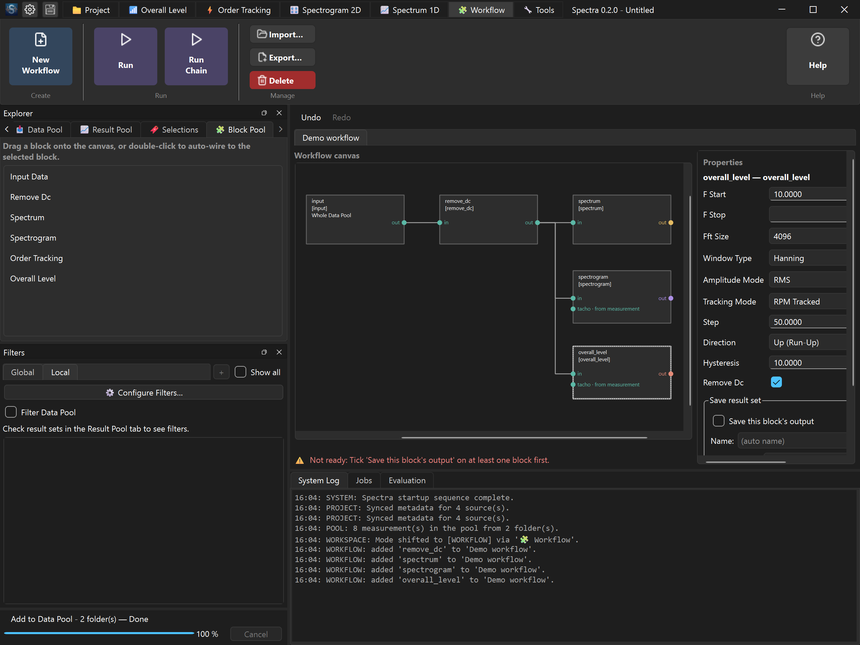
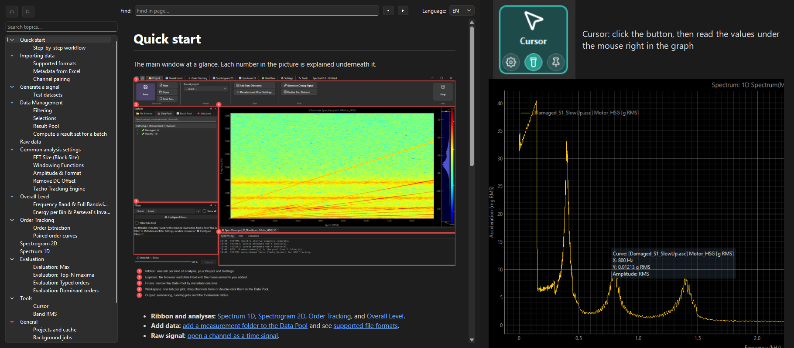

# Changelog

What changed in Spectra, written for users. Rules for writing it: [docs/agents/release.md](docs/agents/release.md).

## Unreleased

## 0.2.0 - 2026-10-14

- Workflow tab is now a block canvas: drag, wire and arrange blocks, undo / redo, and run all chains or one with Run Chain.
  
- New Settings window (gear icon) replaces the Settings tab, with search, Apply / Revert and Reset All; Run Benchmark moved to the Project tab.
- Project, cache and settings files from much older versions are no longer read; old results are recomputed.
- New Theme setting (Dark / Light) switches the whole application look after restart.
- Graph curves use a new 12-colour palette and stay smooth with many curves.
- Data Pool asks whether MASTA, processed and ANSYS amplitudes are RMS or Peak, so curves are no longer off by √2.
- MASTA workbooks with one sheet per order (H1, H4.79, …) are now read sheet by sheet; ANSYS harmonic-response CSV files can be added as a first-order curve.
- Fixed: opening a project no longer marks it as unsaved, and starting an Update no longer shows "Not responding".

## 0.1.2 - 2026-10-08

- New Cursor on the Tools tab: hover a graph and read the values of the curve in a box right.
- Cursor Settings let you choose and order the fields the box shows.
- Highlight thickens the curve under the mouse and dims the others; Pin freezes the box in place.
- New built-in Help window with a quick start and a full reference, in English and Czech.
  
- Minor bug fixes.

## 0.1.1 - 2026-10-05

- Opening a project that is already open now brings its existing window to the front instead of opening a second one.

## 0.1.0 - 2026-10-05

- First public alpha: spectra, spectrograms, order tracking and trending across large sets of measurements.
